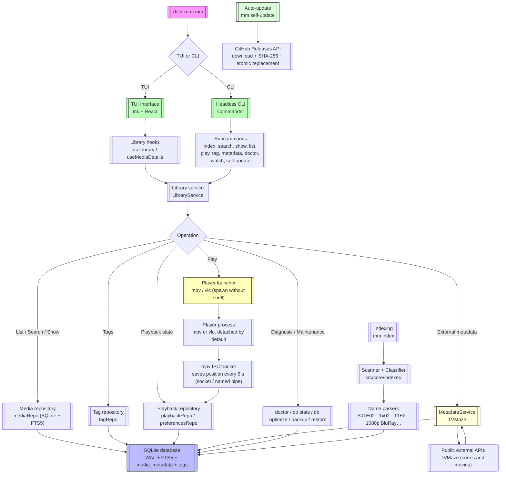

<p align="center">
  
</p>

<h1 align="center">media-manager</h1>

<p align="center">
  <strong>100% terminal multimedia content manager</strong><br/>
  Index your series and movie collection in a local SQLite database<br/>
  and launch it directly in <code>mpv</code> or <code>vlc</code> without leaving the terminal.
</p>

<p align="center">
  <a href="https://github.com/Angel-p-v/media-manager/releases/latest">
    
  </a>
  <a href="https://github.com/Angel-p-v/media-manager/actions/workflows/ci.yml">
    
  </a>
  <a href="https://github.com/Angel-p-v/media-manager/blob/main/LICENSE">
    
  </a>
  <a href="https://nodejs.org/">
    
  </a>
  <a href="https://github.com/Angel-p-v/media-manager/releases">
    
  </a>
</p>

---

## 🎬 Demo

<p align="center">
  
</p>

> **The demo is a static transcription of a real session.** To try it in your terminal, start with the [quick install](#quick-install) section.

---

## ⚡ Get started in 30 seconds

```bash
# 1. Clone and install (Linux, without sudo)
git clone https://github.com/Angel-p-v/media-manager.git
cd media-manager
sh installers/linux/install.sh

# 2. Open the interface
mm

# 3. From the CLI
mm index                          # re-scans your library
```

Windows and macOS: see [Quick install](#quick-install).

---

## 🎯 What is media-manager?

`media-manager` (CLI: `mm`) is a **100% terminal** command-line application to organize and consume a personal multimedia library that already lives on your disk.

> **The idea is simple:** your videos are already organized in folders; the app's job is to **understand** that structure, store it in a fast index, and let you start watching something in two taps.

```bash
mm                       # opens the interface (TUI) with your library
mm index                 # re-scans your folders and updates the index
```

---

## ✨ Why media-manager?

| 🎯 **Centralize access**      | A single entry point (`mm`) to your entire collection, without depending on the file explorer or the streaming server's website.            |
| ----------------------------- | ------------------------------------------------------------------------------------------------------------------------------------------- |
| ⚡ **Local, instant indexer** | A SQLite index with FTS5 turns "searching among 10,000 files" into "searching among 10,000 rows" with full-text search.                     |
| 🎮 **Play, don't stream**     | The video opens in your local player (`mpv`, `vlc`) with the hardware and quality you already have; the app only orchestrates the process.  |
| ⚙️ **Truly configurable**     | Paths, exclusions, players, theme, and keyboard shortcuts live in an external `config.yaml`, strictly validated at startup.                 |
| 🔧 **Composable**             | Everything the TUI does can also be done from the command line and in `--json` format, to integrate with scripts, hooks, or any other tool. |

---

## ✨ Main features

| Capability                                                       | Status |
| ---------------------------------------------------------------- | ------ |
| 🖥️ Navigable TUI (Ink + React)                                   | ✅     |
| 🗃️ Local index in SQLite with FTS5                               | ✅     |
| 🔄 Recursive + incremental indexing                              | ✅     |
| 🎯 Smart parsing (`S01E02`, `1x02`, `T1E2`, `1080p BluRay`)      | ✅     |
| 🔍 Instant search (CLI + TUI)                                    | ✅     |
| 🎮 Playback with `mpv` / `vlc`                                   | ✅     |
| ⚙️ YAML config validated with Zod                                | ✅     |
| 👀 _Watch_ mode (automatic reindexing)                           | ✅     |
| 📤 `--json` output for scripts                                   | ✅     |
| 📝 Structured logs, `--verbose`, errors with code                | ✅     |
| 🗄️ SQLite maintenance (`optimize` / `VACUUM`)                    | ✅     |
| ✅ Verified installer, checksums, portable distribution          | ✅     |
| ▶️ Playback state (continue, history, marks)                     | ✅     |
| 📡 mpv IPC tracker (automatic resume and position saving)        | ✅     |
| 🎮 Commands `continue`, `history`, `mark`, `favorite`, `doctor`  | ✅     |
| 📃 `playlist` command (plays multiple titles in sequence)        | ✅     |
| 🗄️ Commands `db stats`, `db optimize`, `db backup`, `db restore` | ✅     |
| 🏷️ Commands `tag add/remove/list` and filter `list --tag`        | ✅     |
| 🔄 Auto-update with `self-update`                                | ✅     |
| 📋 "Continue" section in the TUI                                 | ✅     |
| 🧩 Player integration (mpv/vlc, detach/foreground mode)          | ✅     |
| 🧪 E2E tests with fake IPC and `--dry-run`                       | ✅     |
| 🎞️ External TVMaze metadata (synopsis, rating)                   | ✅     |
| 🔄 Automatic metadata sync with TTL                              | ✅     |
| 🤖 Sonarr/Radarr-style automatic metadata (`autoFetch`)          | ✅     |

## 🚀 Quick install

### 📦 Official installer (recommended — Linux, Windows)

Clone the repository and run the installer corresponding to your system.

#### Linux (x64, arm64)

```bash
# 1. Clone the repository
git clone https://github.com/Angel-p-v/media-manager.git
cd media-manager

# 2. Install Node.js dependencies (required for repository mode)
npm ci

# 3. Run the installer (without sudo, installs in ~/.local)
sh installers/linux/install.sh

# If already installed, use --force to reinstall:
# sh installers/linux/install.sh --force

# 4. Verify
mm --version
```

> 💡 Make sure `~/.local/bin` is in your PATH **before** other version managers (such as `mise`, `nvm`, etc.) so that `mm` resolves correctly.

> 📦 Alternative: if you don't want to clone the repository, download the installer directly and it will obtain a precompiled release from GitHub Releases (no node or npm required):
>
> ```bash
> curl -fsSL https://raw.githubusercontent.com/Angel-p-v/media-manager/main/installers/linux/install.sh -o /tmp/mm-install.sh
> sh /tmp/mm-install.sh
> ```

#### Windows (x64)

```powershell
# 1. Clone the repository
git clone https://github.com/Angel-p-v/media-manager.git
cd media-manager

# 2. Run the installer
.\installers\windows\install.ps1

# 3. Verify
mm --version
```

#### macOS (x64, arm64)

> **Note:** There are no official macOS assets in public releases (pending GitHub Actions runners with macOS). See [`installers/macos/README.md`](./installers/macos/README.md) to compile and install on macOS.

To compile on macOS:

```bash
npm run standalone -- --node-source official
```

> **Useful options:**
>
> ```bash
> sh installers/linux/install.sh --prefix "$HOME/.local"
> sh installers/linux/install.sh --dry-run            # shows changes without applying them
> ```

## 🔧 System dependencies

Besides the `mm` binary (which already includes Node.js bundled in official distributions), media-manager needs some system programs to work at 100%:

| Dependency       | Purpose                                                   | Mandatory           | Installation                                                                       |
| ---------------- | --------------------------------------------------------- | ------------------- | ---------------------------------------------------------------------------------- |
| **mpv**          | Main player (recommended)                                 | ❌ (mpv or vlc)     | `sudo apt install mpv` / `winget install mpv` / `brew install mpv`                 |
| **vlc**          | Alternative player                                        | ❌ (mpv or vlc)     | `sudo apt install vlc` / `winget install videolan.vlc` / `brew install --cask vlc` |
| **Node.js ≥ 22** | Only if you clone the repo and run from source (`npm ci`) | ⚠️ Source mode only | [`nodejs.org`](https://nodejs.org/) or your version manager                        |

> 💡 None of these dependencies is strictly required to use the TUI or search.

### Check what's missing on your system

```bash
mm doctor
```

`mm doctor` tells you which players, tools, and index entries are available or missing, and can clean up broken entries with `--prune-missing`.

---

## 🗑️ Uninstall

```bash
# Clone the repository if you don't have it yet
git clone https://github.com/Angel-p-v/media-manager.git
cd media-manager

# Run the uninstaller (without sudo)
sh installers/linux/uninstall.sh            # preserves configuration and database
sh installers/linux/uninstall.sh --purge    # removes them too
```

> 🛡️ The multimedia library is never touched.

#### macOS: if Gatekeeper blocks the binary

If when running `mm` you see an "app not verified" or "cannot be opened because it is not from an identified developer" error:

```bash
# Remove the quarantine attribute from installed binaries
xattr -d com.apple.quarantine ~/.local/share/media-manager/dist/cli.js ~/.local/bin/mm
```

The installer tries to do this automatically, but in some cases macOS re-applies it.

---

## 🚀 Quick usage

```bash
# 🖥️ Visual interface (TUI)
mm

# 📋 Library management
mm index                           # scans and updates

# ✅ Diagnosis
mm doctor                              # library diagnosis
mm doctor --prune-missing              # cleans up broken entries

# 🔄 Auto-update
mm self-update --check             # checks for updates
mm self-update                     # downloads and installs the new version
mm self-update --dry-run           # shows what would be done without installing
```

---

## ⌨️ TUI shortcuts

| Key            | Action                                                       |
| -------------- | ------------------------------------------------------------ |
| `q` / `Ctrl+C` | Exit                                                         |
| `Tab`          | Next section (All, Continue, Series, Movies)                 |
| `↑` `↓`        | Move selection                                               |
| `/`            | Search • `Esc` goes back                                     |
| `p`            | ▶️ Play                                                      |
| `w`            | Mark watched / unwatched                                     |
| `f`            | ⭐ Favorite / remove favorite                                |
| `m`            | 📋 Show/hide details panel                                   |
| `r`            | 🔄 Fetch metadata for selected title                         |
| `n`            | ▶️ Next episode                                              |
| `g`            | 🔄 Cycle filters (all / in progress / unwatched / favorites) |
| `s`            | ⚙️ Settings                                                  |
| `?`            | ❓ Help                                                      |
| `k`            | ⌨️ Reassign keyboard shortcuts (from the TUI)                |

---

## 🐚 Shell autocomplete

`mm` can generate autocomplete scripts for Bash, Zsh, and Fish:

```bash
# Generate the script
mm completion bash   # or: zsh | fish

# Install (examples for Bash)
mm completion bash > /etc/bash_completion.d/mm
# or for user:
mm completion bash >> ~/.bashrc

# Zsh
mm completion zsh > /usr/local/share/zsh/site-functions/_mm
# or for user:
mm completion zsh >> ~/.zshrc

# Fish
mm completion fish > ~/.config/fish/completions/mm.fish
```

After installing, restart the shell or reload its configuration for `mm` commands and options to autocomplete when pressing <kbd>Tab</kbd>.

---

## ⚙️ Configuration

File: `~/.config/media-manager/config.yaml` (respects `XDG_CONFIG_HOME`)

```yaml
version: 1

library:
  roots:
    - path: ~/Media/Series
      type: series
      label: Series
    - path: ~/Media/Movies
      type: movie
      label: Movies
  exclude:
    - '**/*.sample.*'
    - '**/sample/**'
  scan:
    followSymlinks: false
    maxDepth: 4

database:
  path: ~/.local/share/media-manager/library.db

player:
  default: mpv
  onLaunch: detach
  players:
    mpv:
      command: mpv
      args: ['--force-window=immediate', '--start={start}', '{file}']
    vlc:
      command: vlc
      args: ['--started-from-file', '--start-time={start}', '{file}']

playback: # 🎬 Playback state
  tracking: auto # auto | manual | off (mpv only)
  resume: true # resume by default
  resumeMinSeconds: 30 # minimum to resume
  completedThreshold: 0.9 # 90% = completed
  completedTailSeconds: 30 # last 30s = completed

ui:
  theme: default
  layout: split
  sort: title

logging:
  level: warn
  format: text

metadata:
  cacheTtlHours: 24 # hours before refreshing metadata
  autoFetch: false # true = fetch metadata when opening TUI

keybindings:
  quit: q
  help: '?'
  search: /
  play: p
  nextSection: tab
```

### 🤖 Automatic metadata (Sonarr/Radarr-style)

If you enable `metadata.autoFetch: true`, when opening the TUI metadata will be automatically searched for **all titles that don't have it yet**, using free public providers (TVMaze for series and movies), without having to press `r` on each one individually.

```yaml
metadata:
  autoFetch: true
```

The process respects each provider's rate limiting and processes titles in batches to avoid blocking the application. At the end, you'll see a summary in the status bar with how many metadata items were obtained and how many failed.

> **💡 By default** `autoFetch` is disabled (`false`) to avoid unexpected API calls.

> **⌨️ Key `r`**: if you prefer to fetch metadata title by title manually, press `r` on any selected title in the library.

> **💡 `{start}` placeholder**: if the template includes it and there is a resume position, it is replaced with seconds; if there is no resume, the entire argument is removed.

### Environment variables

| Variable           | Effect                           |
| ------------------ | -------------------------------- |
| `MM_CONFIG`        | Alternative YAML path            |
| `MM_DATABASE_PATH` | Alternative SQLite path          |
| `MM_PLAYER`        | Default player                   |
| `MM_LOG_LEVEL`     | Logging level (`silent`…`debug`) |
| `MM_LOG_FORMAT`    | Format (`text` or `json`)        |
| `NO_COLOR`         | Disables colors                  |

---

## 🏗️ Architecture

Guiding principle: **business logic doesn't know a terminal exists.**

```
src/
├─ cli.tsx        # entry point; delegates to commands/ or the TUI
├─ commands/      # headless subcommands (don't depend on Ink)
├─ core/          # pure domain: config, db, indexer, library, player
├─ ui/            # presentation with Ink (React) — only consumes core/
└─ shared/        # cross-cutting utilities: errors, logger, paths
```

**Rules verified in CI:**

- `core/` **never** imports from `ui/`
- `ui/` and `commands/` use use cases, not direct SQL
- Data access via repositories with injected `Database`

---

## 📊 Flow diagram



---

## 🛠️ Development

```bash
npm install          # installs dependencies (prepares Husky hooks)
npm run dev          # CLI in watch mode
npm run verify       # lint + format + types + tests (local gate)
npm test             # full suite (635 tests)
npm run test:unit    # unit tests only
npm run test:integration
npm run test:e2e
npm run coverage     # coverage report
npm run bench        # benchmarks
npm run smoke        # npm pack → clean install → smoke test
npm run standalone   # portable distribution with Node included
```

### Quality and CI

| Tool                    | Configuration                        |
| ----------------------- | ------------------------------------ |
| **ESLint 10**           | type-aware + `typescript-eslint`     |
| **Prettier 3**          | consistent formatting                |
| **Vitest 5**            | 3 projects: unit / integration / e2e |
| **Husky + lint-staged** | format + lint in pre-commit          |
| **commitlint**          | Conventional Commits                 |
| **CI (GitHub Actions)** | Node 22/24/26 + real smoke test      |

---

## 📚 Documentation

| Document                                                       | Description                       |
| -------------------------------------------------------------- | --------------------------------- |
| [`PLAN.md`](./PLAN.md)                                         | Development plan by milestones    |
| [`docs/README.md`](./docs/README.md)                           | Documentation index               |
| [`docs/guides/architecture.md`](./docs/guides/architecture.md) | Technical decisions               |
| [`docs/guides/performance.md`](./docs/guides/performance.md)   | Budget and benchmarks             |
| [`docs/guides/release.md`](./docs/guides/release.md)           | Publishing, tags, and credentials |
| [`docs/adr/`](./docs/adr)                                      | Architecture Decision Records     |
| [`docs/plans/`](./docs/plans)                                  | Work plans                        |
| [`CHANGELOG.md`](./CHANGELOG.md)                               | Version history                   |
| [`SECURITY.md`](./SECURITY.md)                                 | Report vulnerabilities            |
| [`CONTRIBUTING.md`](./CONTRIBUTING.md)                         | Development flow and PRs          |

---

## 📄 License

[MIT](./LICENSE) © 2026 media-manager contributors

<p align="center">
  <sub>Made with ❤️ for those who prefer the terminal.</sub><br/>
  <sub><a href="https://github.com/Angel-p-v/media-manager/issues">Report bug</a> • <a href="https://github.com/Angel-p-v/media-manager/discussions">Ask</a> • <a href="https://github.com/Angel-p-v/media-manager/blob/main/CONTRIBUTING.md">Contribute</a></sub>
</p>
